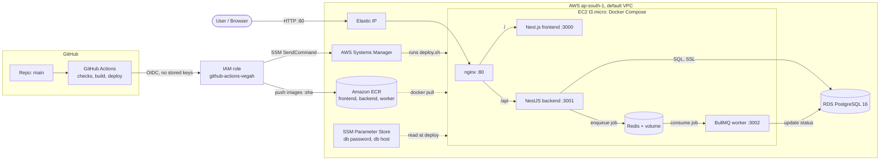

# Vegah DevOps Assessment: Full-stack app on AWS

A Next.js + NestJS + PostgreSQL + Redis/BullMQ application, containerized with Docker, built and deployed automatically by GitHub Actions to AWS.

- **Live URL:** http://13.205.250.189/
- **Health endpoint:** http://13.205.250.189/api/health
- **Region:** ap-south-1 (Mumbai)

## What the app does

A user submits text in the UI. The backend stores a job in PostgreSQL and enqueues it in Redis (BullMQ). The worker picks it up, processes it for about 5 seconds, and writes the result back. The UI polls the API and shows `queued → processing → completed` (or `failed` after 3 retries).

## Architecture



| Component | Where it runs | Notes |
|---|---|---|
| nginx | EC2 container | Only public entry point (port 80). `/` goes to the frontend, `/api` to the backend |
| Frontend (Next.js) | EC2 container | Calls the relative path `/api`, so one image works in every environment |
| Backend (NestJS) | EC2 container | REST API, enqueues jobs, creates the `jobs` table on startup |
| Worker (BullMQ) | EC2 container | Separate image, exposes an internal health endpoint |
| Redis | EC2 container + named volume | AOF persistence enabled |
| PostgreSQL | **Amazon RDS** (db.t4g.micro) | Private, reachable only from the app's security group |
| Images | Amazon ECR | Tagged with the commit SHA and `latest` |

## Repository layout

```
backend/    NestJS API + Dockerfile (multi-stage)
frontend/   Next.js UI + Dockerfile (multi-stage, standalone output)
worker/     BullMQ worker + Dockerfile (multi-stage)
nginx/      Reverse proxy config
docker-compose.yml        Local development stack (includes Postgres)
docker-compose.prod.yml   Production stack (RDS replaces the Postgres container)
deploy/deploy.sh          Server-side deploy with health check and rollback
.github/workflows/        CI/CD pipeline
infra/                    IAM policy / bootstrap files used to create the AWS resources
docs/architecture.mmd     Diagram source
```

## Run locally (one command)

```bash
cp .env.example .env        # set POSTGRES_PASSWORD (letters and digits only)
docker compose up --build -d
docker compose ps           # all services should be (healthy)
```

Open http://localhost. If port 80 is taken on your machine, change the nginx port mapping to `8080:80`.

## Environment variables

| Variable | Used by | Purpose | Where it is set |
|---|---|---|---|
| `POSTGRES_USER`, `POSTGRES_PASSWORD`, `POSTGRES_DB` | local Postgres | Local DB credentials | `.env` (git-ignored; template in `.env.example`) |
| `DATABASE_URL` | backend, worker | Postgres connection string | Local: built by compose. AWS: built at deploy time from SSM |
| `REDIS_HOST`, `REDIS_PORT` | backend, worker | Redis location | Compose file (`redis`, `6379`) |
| `ECR_REGISTRY`, `TAG` | prod compose | Which images to run | Exported by `deploy.sh` |

GitHub configuration:

| Name | Type | Purpose |
|---|---|---|
| `AWS_ROLE_ARN` | Secret | IAM role assumed through OIDC |
| `AWS_REGION` | Variable | `ap-south-1` |
| `EC2_INSTANCE_ID` | Variable | Deploy target |
| `APP_URL` | Variable | Public URL for the smoke test |

AWS SSM Parameter Store: `/vegah/db_password` (SecureString), `/vegah/db_host`.

No credentials are committed to the repository.

## CI/CD pipeline (GitHub Actions)

Trigger: push to `main` (pull requests run the checks only).

```
checks (x3)  ->  build-and-push (x3)  ->  deploy
```

1. **checks:** `npm ci` plus build (backend, frontend) or syntax check (worker). Any failure stops the pipeline, so a failed build is never deployed.
2. **build-and-push:** builds each image and pushes it to ECR tagged `:<commit-sha>` and `:latest`. Docker layer cache (GitHub Actions cache) and npm cache avoid unnecessary rebuilding. A `concurrency` rule cancels superseded runs.
3. **deploy:** the GitHub runner assumes an AWS role through **OIDC** (no stored AWS keys) and runs `deploy/deploy.sh <sha>` on the EC2 instance through **SSM Run Command** (no SSH, port 22 is closed). A public smoke test then calls `/api/health`.

`deploy.sh` pulls the exact SHA-tagged images, restarts the stack, and polls `/api/health` for up to 150 seconds. On success it records the SHA as the last known-good release. On failure it redeploys the previous good SHA and exits non-zero, so the pipeline goes red while the site keeps serving the old version.

## Deploying and rolling back by hand

Deploy a specific version:

```bash
aws ssm send-command --instance-ids <INSTANCE_ID> --document-name AWS-RunShellScript \
  --parameters 'commands=["bash /opt/app/deploy/deploy.sh <GIT_SHA>"]'
```

Rollback is the same command with an older SHA. Older images remain in ECR (lifecycle policy keeps the last 10).

## Production practices (Task 5)

**How do you handle application crashes?**
Every service has `restart: unless-stopped`, so Docker restarts a crashed container. Docker health checks mark unhealthy services, and `depends_on: condition: service_healthy` controls startup order. BullMQ retries failed jobs 3 times with exponential backoff, and the worker marks a job `failed` only after the last attempt. If a bad release crashes on startup, the deploy health check fails and it is rolled back automatically.

**How do you prevent secrets from being exposed?**
- `.env` is git-ignored. Only `.env.example` with placeholders is committed.
- The RDS password is random, generated at provisioning time, and stored in SSM Parameter Store as a SecureString. The server reads it at deploy time using its instance role, limited to `/vegah/*`.
- GitHub reaches AWS through OIDC, so there are no long-lived AWS keys in GitHub. The trust policy is limited to this repository's `main` branch.
- The only secret in GitHub is a role ARN, which is an identifier and not a credential.
- No SSH keys exist, and the database is not publicly accessible.

**How do you manage database persistence?**
PostgreSQL runs on RDS, so data is independent of the containers and the EC2 instance, with automated backups (1-day retention). Locally, a named Docker volume (`pgdata`) keeps the data across `down`/`up`. Redis uses AOF persistence on a named volume.

**How would you roll back a failed deployment?**
Automatically: `deploy.sh` redeploys the last known-good SHA when the health check fails. Manually: run `deploy.sh` with any earlier commit SHA through SSM, since every image is tagged with its SHA and kept in ECR.

**How would you investigate a failing container?**
1. Check the Actions deploy log, which prints server output and the backend's last log lines on failure.
2. Run `docker compose -f docker-compose.prod.yml ps` and `docker logs <container>` on the server through SSM.
3. Run `docker inspect` to see the health check output and exit code.
4. Check dependencies: Redis reachability, RDS connectivity (security group, credentials in SSM), and `docker stats` / `free -m` for memory pressure (t3.micro has 1 GB RAM plus 2 GB swap).

**How would you monitor application health?**
Currently: Docker health checks on every container, the deploy-time check, and a public smoke test after each deploy. Next steps: a CloudWatch alarm on EC2 status checks and RDS CPU/storage, container logs shipped to CloudWatch Logs, and an external uptime monitor on `/api/health`.

## Important decisions

- **EC2 + Docker Compose instead of ECS/Kubernetes:** cheapest option within free-tier limits, and the assessment allows Compose.
- **RDS for PostgreSQL, Redis in a container:** the database is the state that matters, so it is managed. ElastiCache has no free tier, and Redis here only holds a transient job queue.
- **nginx single entry point:** one public URL, no CORS, and the frontend image needs no build-time API URL.
- **OIDC + SSM instead of access keys + SSH:** no long-lived credentials and a smaller attack surface.
- **Rollback logic on the server:** the health check and rollback still run if the CI runner disconnects.
- **`node:20-slim` base images:** Debian-based, with multi-stage builds to keep runtime images small and without dev dependencies.

## Limitations (known and intentional)

- Single EC2 instance and single-AZ RDS: no high availability.
- HTTP only, no TLS or custom domain. Production would use an ALB with ACM and Route 53.
- Redis runs on the instance. Production would use ElastiCache.
- The database connection uses `sslmode=no-verify` (encrypted, but the server certificate is not verified). Production would bundle the RDS CA bundle and verify it.
- The schema is created with `CREATE TABLE IF NOT EXISTS` at startup, so there is no migration tool.
- No automated tests beyond build and syntax checks.
- Logging and alerting are basic: no CloudWatch alarms configured.
